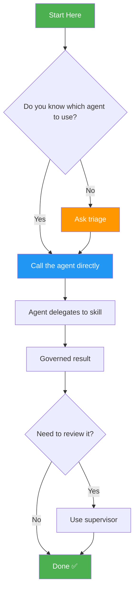

# 🚀 Quick Start

> Get up and running with the Copilot Governance Framework in 5 minutes.

## Prerequisites

- [VS Code](https://code.visualstudio.com/) with [GitHub Copilot](https://github.com/features/copilot) enabled
- GitHub Copilot Chat extension installed

## Setup

### 1. Clone the repository

```bash
git clone https://github.com/l3onkers/copilot-governance-framework.git
cd copilot-governance-framework
```

### 2. Open in VS Code

```bash
code .
```

### 3. Verify Copilot is active

Open GitHub Copilot Chat (Ctrl+Shift+I or Cmd+Shift+I) and verify it's connected.

---

## Your First Request

### Option A: Let Triage Route It

If you don't know which agent to use, ask triage:

```
@workspace I need to scaffold a new Python API with database connectors and tests.
```

Triage will:
1. Identify this as a Python build request
2. Route to `py-build`
3. Expand the layer dependencies: `environment` → `api` → `connectors` → `pytest` → `pytest-fastapi`
4. Execute each layer skill in order

### Option B: Call an Agent Directly

If you know which agent to use:

```
@workspace Use ng-build to scaffold an Angular SPA called "my-app" with SSO login.
```

### Option C: Invoke a Skill Directly

Some skills can be invoked without going through an agent:

```
@workspace Use git-workflow to create a PR body for my changes.
```

---

## Common Workflows

### Scaffold a .NET API

```
@workspace Use net-build to scaffold a CQRS API called "order-service".
```

The agent will:
- Resolve the `api-cqrs` profile
- Load shared .NET governance rules
- Generate a Clean Architecture scaffold with MediatR
- Validate against the .NET checklist

### Scaffold an Angular SPA

```
@workspace Use ng-build to scaffold a SPA called "dashboard" with SSO login.
```

The agent will:
- Resolve the `spa` profile
- Load Angular governance (versions, dependencies, folder structure)
- Generate the SPA shell with header wrapper
- Generate SSO login components and services
- Validate against the Angular checklist

### Run a Security Audit

```
@workspace Use security to generate SECURITY_AUDIT.md for this repository.
```

### Review a Bundle for Compliance

```
@workspace Use supervisor to review .github/skills/git-workflow/SKILL.md.
```

### Generate Repository Documentation

```
@workspace Use documentator to regenerate the repository README.md.
```

---

## Understanding the Output

Every agent produces a **governed result** that includes:

1. **Generated files** — The actual scaffold, documentation, or report
2. **Validation results** — Checklist verification showing what passed
3. **Dependency list** — What packages and versions were used
4. **Next steps** — What commands to run or actions to take

---

## How to Approach the Repository



1. **Start with triage** if you're unsure which agent handles your request
2. **Provide one explicit target** — a bundle name, profile token, or layer set
3. **Let the skill own the details** — templates, checklists, and generation rules
4. **Review the result** — use `supervisor` for compliance checks
5. **Use git-workflow** for branch names, commit messages, and PR bodies

---

## Customization

> **Note:** The process table below is a template. Customize the roles and steps to match your organization's workflow.

If you're adapting this framework for your organization, see the [Customization Guide](docs/CUSTOMIZATION.md) for:
- Changing company branding and namespaces
- Integrating your UI component library
- Updating tech stack versions
- Configuring your package registry
- Setting up your CI/CD platform

---

## Next Steps

| What to do | Where to look |
|-----------|--------------|
| Understand the architecture | [docs/ARCHITECTURE.md](docs/ARCHITECTURE.md) |
| Browse all agents | [docs/AGENTS.md](docs/AGENTS.md) |
| Browse all skills | [docs/SKILLS.md](docs/SKILLS.md) |
| Create your own agent | [docs/CREATING_AGENTS.md](docs/CREATING_AGENTS.md) |
| Create your own skill | [docs/CREATING_SKILLS.md](docs/CREATING_SKILLS.md) |
| Customize for your org | [docs/CUSTOMIZATION.md](docs/CUSTOMIZATION.md) |
