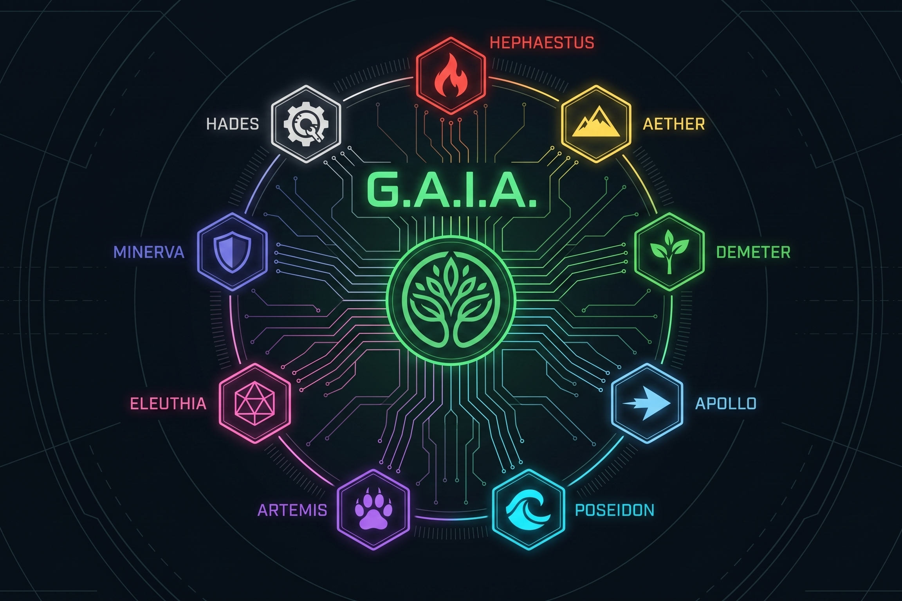
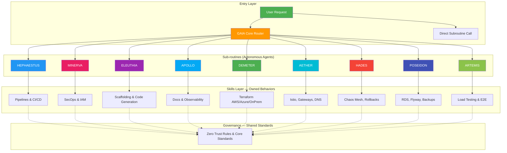

<p align="center">
  
</p>

<h1 align="center">G.A.I.A.</h1>
<h3 align="center">Governance through Autonomous Infrastructure Agents</h3>
<p align="center"><i>The Autonomous Platform Engineering & Development Framework</i></p>

<p align="center">
  <a href="LICENSE">
    
  </a>
  <a href="https://github.com/features/copilot">
    
  </a>
</p>

> **An autonomous agent swarm for Platform Engineering, DevOps, and Code Scaffolding, inspired by Horizon Zero Dawn.**

Turn your GitHub Copilot into a deterministic, self-governed orchestration engine that covers the entire software lifecycle: from infrastructure forging to observability and application deployment.

---

## ✨ Why this Framework?

The GAIA (Global Autonomous Infrastructure Architecture) ecosystem abandons monolithic workflows to adopt an *Event-Driven* and *Zero Trust* swarm architecture.

| Problem | GAIA Solution |
|---------|----------|
| Complex requests lack context | **GAIA Core** intelligently routes the user's intent to specialized sub-routines. |
| Inconsistent project scaffolding | **ELEUTHIA** standardizes application scaffolding (.NET, Angular, Python). |
| Manual and fragile infrastructure | **DEMETER** and **HEPHAESTUS** forge pipelines and clusters using IaC (Terraform, K8s). |
| Reactive and monolithic security | **MINERVA** enforces dynamic audits and secret management with a Zero Trust approach. |
| Knowledge decay | **APOLLO** generates ADRs, Runbooks, and keeps observability alive. |

---

## 🏗️ Architecture



## 📋 Sub-routine Catalog

| Sub-routine | Ecosystem Role | Purpose & Capabilities |
|-----------|-----------------------|-------------------------|
| 🌍 **GAIA** | Core Orchestrator | Routes user requests to the appropriate sub-routine based on context and state. |
| 🔨 **HEPHAESTUS**| Forge & CI/CD | Builds containers, pipelines, registries, and scaffolds the framework itself without placeholders. |
| 🛡️ **MINERVA** | DevSecOps & Zero Trust| Vulnerability scanning, auditing, automatic remediation, and secret management. |
| 📚 **APOLLO** | Knowledge & Observability | Living Runbooks, ADRs, dashboard configuration, and compliance review enforcement. |
| 🧬 **ELEUTHIA** | Code Scaffolding | Bootstrapping applications from scratch (.NET, Angular, Python). |
| 🌱 **DEMETER** | IaC & Provisioning | Baseline infrastructure deployment with Terraform across AWS, Azure, and On-Premise. GitOps sync. |
| 🌪️ **AETHER** | Networking | Service Mesh (Istio), API Gateways, ALB Ingress Controllers, DNS, WAF. |
| 💀 **HADES** | Chaos & Destruction | Teardown of ephemeral environments, disaster simulations (Chaos Mesh, AWS FIS), automatic rollbacks. |
| 🌊 **POSEIDON** | Data & Storage | Persistent volume management, database schema migrations (Flyway), automated backups. |
| 🏹 **ARTEMIS** | Quality Assurance (QA) | Bug hunting, E2E test integration (Playwright), load testing (k6). |

> 📖 **Complete Documentation:** [docs/AGENTS.md](docs/AGENTS.md)

---

## 🚀 Quick Start

### 1. Clone the repository

```bash
git clone https://github.com/l3onkers/gaia-autonomous-framework.git
cd gaia-autonomous-framework
```

### 2. Open in VS Code with GitHub Copilot

The GAIA ecosystem operates through GitHub Copilot Chat. Open the repository in VS Code and ensure Copilot is active.

### 3. Contact GAIA

Don't know which sub-routine to use? Ask GAIA:

`@workspace Use gaia to prepare the infrastructure and code for a new .NET microservice with a database.`

GAIA will automatically route the request to **ELEUTHIA** for code generation, **HEPHAESTUS** for pipelines, and **POSEIDON** for the database schema.

### 4. Direct Invocation

If you know the exact sub-routine:

`@workspace Use minerva to run a security review and secret scan on the latest commits.`

> 📖 **Detailed Guide:** [QUICKSTART.md](QUICKSTART.md)

## 📘 Governance Notes

- The canonical agent authoring contract lives in [docs/CREATING_AGENTS.md](docs/CREATING_AGENTS.md).
- The canonical skill authoring contract lives in [docs/CREATING_SKILLS.md](docs/CREATING_SKILLS.md).
- New frontend skills should default to React first unless an existing governed stack explicitly requires another framework.
- Repository structure and documentation consistency are validated by the dedicated workflow in [.github/workflows/validate-gaia-structure.yml](.github/workflows/validate-gaia-structure.yml).

---

## 🤝 Contributing

Contributions are welcome! Please review [CONTRIBUTING.md](CONTRIBUTING.md) before submitting a pull request.

## 📄 License

This project is licensed under the MIT License — see [LICENSE](LICENSE) for details.

## 👤 Author

Created and maintained by **[l3onkers](https://github.com/l3onkers)**.
Evolved into the GAIA Architecture.

