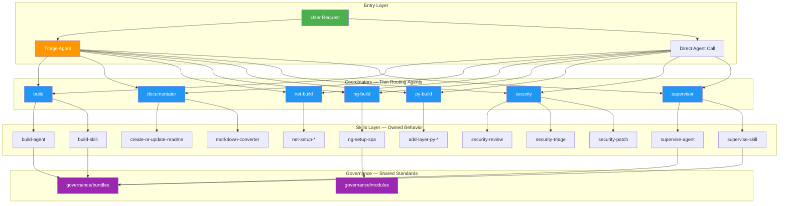

# 🤖 Copilot Governance Framework

[](LICENSE)
[](https://github.com/features/copilot)
[](https://dotnet.microsoft.com/)
[](https://angular.io/)
[](https://www.python.org/)

> **A production-ready framework of AI agents, reusable skills, and governance templates for orchestrating deterministic GitHub Copilot workflows at enterprise scale.**

Turn your GitHub Copilot into a governed, repeatable development workflow engine — not just a code completion tool.

---

## ✨ Why This Framework?

Most teams use GitHub Copilot for ad-hoc code suggestions. This framework takes it further:

| Problem | Solution |
|---------|----------|
| Copilot gives inconsistent outputs across team members | **Deterministic agents** ensure the same request produces the same governed result |
| No standard scaffolding for new projects | **Stack-specific build agents** (Angular, .NET, Python) enforce architecture standards |
| Security reviews are manual and inconsistent | **Security ecosystem** with 6 specialized skills automates audits, reviews, and patches |
| Documentation drifts from reality | **Documentation agents** regenerate README and export artifacts from live repo state |
| New team members don't know where to start | **Triage agent** routes any request to the right workflow automatically |

---

## 🏗️ Architecture



**Core design principle:** Agents are *thin routers* — they resolve one bounded path and delegate all detail to the owning skill. Skills own templates, checklists, validation, and generation logic.

---

## 📋 Agent Catalog

| Agent | Purpose | Delegates To |
|-------|---------|-------------|
| 🔀 **triage** | Routes any request to the strongest matching agent | All agents below |
| 🏗️ **build** | Authors new governed agent or skill bundles | `build-agent`, `build-skill` |
| 📄 **documentator** | Generates or refreshes README and documentation | `create-or-update-readme`, `markdown-converter` |
| 🟣 **net-build** | Orchestrates .NET project scaffolding (6 profiles) | `net-setup-api`, `net-setup-worker`, `net-setup-job`, etc. |
| 🔴 **ng-build** | Orchestrates Angular SPA scaffolding | `ng-setup-spa` + design reference skills |
| 🐍 **py-build** | Orchestrates Python project layers with dependency resolution | `add-layer-py-*` (7 layer skills) |
| 🔒 **security** | Routes security audits, reviews, patches, and event-driven scans | 6 specialized security skills |
| 👁️ **supervisor** | Reviews governed bundles for compliance | `supervise-agent`, `supervise-skill` |

> 📖 **Full documentation:** [docs/AGENTS.md](docs/AGENTS.md)

---

## 🛠️ Skills Catalog

### Build & Setup (14 skills)

| Skill | Stack | Description |
|-------|-------|-------------|
| `net-setup-api` | .NET | Standard REST API scaffold |
| `net-setup-api-cqrs` | .NET | CQRS-pattern API scaffold |
| `net-setup-api-modular` | .NET | Modular architecture API |

| `net-setup-worker` | .NET | Background worker service |
| `net-setup-job` | .NET | Scheduled job service |
| `ng-setup-spa` | Angular | Single-page app with optional SSO login |
| `add-layer-py-environment` | Python | Environment configuration and secrets management |
| `add-layer-py-api` | Python | FastAPI application scaffold |
| `add-layer-py-logger` | Python | Structured logging setup |
| `add-layer-py-connectors` | Python | Database and SFTP connectors |
| `add-layer-py-pytest` | Python | Test suite with pytest |
| `add-layer-py-pytest-fastapi` | Python | FastAPI-specific test harness |
| `add-layer-py-cicd` | Python | CI/CD pipeline configuration |

### Security (6 skills)

| Skill | Description |
|-------|-------------|
| `security-review` | Code-level vulnerability analysis |
| `security-triage` | Prioritized security evidence triage |
| `security-patch` | Minimal, governed fix proposals with approval gates |
| `pr-security-review` | Automated PR security comments |
| `commit-secret-scan` | Secret detection on pushed commits |
| `dependency-security-check` | Dependency manifest vulnerability check |

### Documentation & Governance (7 skills)

| Skill | Description |
|-------|-------------|
| `create-or-update-readme` | Template-driven README generation |
| `markdown-converter` | Pandoc-based export (HTML, PDF, DOCX, TeX, EPUB) |
| `git-workflow` | Governed branch naming, commit formatting, PR bodies |
| `build-agent` | Scaffolds new agent bundles from governance templates |
| `build-skill` | Scaffolds new skill bundles from governance templates |
| `supervise-agent` | Compliance review for agent bundles |
| `supervise-skill` | Compliance review for skill bundles |

### Design System (3 skills)

| Skill | Description |
|-------|-------------|
| `components-catalog` | Corporate UI component reference library |
| `mockup-layouts` | Governed page layout patterns |
| `global-styles` | Utility classes and design tokens |

### Infrastructure (3 skills)

| Skill | Description |
|-------|-------------|
| `add-layer-py-frontend` | Python interactive frontend layer |
| `add-layer-net-cicd` | .NET CI/CD pipeline layer |
| `add-layer-local-postgre-db` | Local PostgreSQL with Docker Compose |

> 📖 **Full documentation:** [docs/SKILLS.md](docs/SKILLS.md)

---

## 🚀 Quick Start

### 1. Clone the repository

```bash
git clone https://github.com/l3onkers/copilot-governance-framework.git
cd copilot-governance-framework
```

### 2. Open in VS Code with GitHub Copilot

The framework works through GitHub Copilot Chat. Open the repository in VS Code with Copilot enabled.

### 3. Start with Triage

Don't know which agent to use? Ask the triage agent:

```
@workspace Use triage to route my request: I need to scaffold a new Python API with database connectors.
```

The triage agent will automatically route your request to `py-build`, which will resolve the required layers (`environment` → `api` → `connectors`) in dependency order.

### 4. Or call an agent directly

```
@workspace Use ng-build to scaffold a new Angular SPA called "my-dashboard" with SSO login.
```

> 📖 **Detailed guide:** [QUICKSTART.md](QUICKSTART.md)

---

## 🎨 Customization

This framework is designed to be forked and adapted to your organization:

| What to customize | How |
|---|---|
| **Company branding** | Replace `corp-*` prefixes and `Company.*` namespaces |
| **UI components** | Swap the stub in `governance/modules/angular/` with your library |
| **Tech stack versions** | Update version pins in `ng-build.tpl.md` and `net-build.tpl.md` |
| **Add a new agent** | Use the `build` agent or follow [docs/CREATING_AGENTS.md](docs/CREATING_AGENTS.md) |
| **Add a new skill** | Use the `build` agent or follow [docs/CREATING_SKILLS.md](docs/CREATING_SKILLS.md) |
| **Package registry** | Update registry references in governance modules |

> 📖 **Full guide:** [docs/CUSTOMIZATION.md](docs/CUSTOMIZATION.md)

---

## 📁 Repository Structure

```
.github/
├── AGENT.md                          # Routing guide — start here
├── copilot-content-exclusion.yaml    # Content exclusion policy
├── agents/                           # 8 callable coordinators
│   ├── triage.agent.md
│   ├── build.agent.md
│   ├── documentator.agent.md
│   ├── net-build.agent.md
│   ├── ng-build.agent.md
│   ├── py-build.agent.md
│   ├── security.agent.md
│   └── supervisor.agent.md
├── skills/                           # 33 reusable governed skills
│   ├── build-agent/
│   ├── build-skill/
│   ├── create-or-update-readme/
│   ├── security-review/
│   ├── net-setup-api/
│   ├── ng-setup-spa/
│   ├── add-layer-py-*/
│   └── ...
└── governance/                       # Shared standards & templates
    ├── bundles/                      # Agent & skill scaffolds
    └── modules/                      # Package fallbacks
docs/                                 # Documentation
├── ARCHITECTURE.md
├── AGENTS.md
├── SKILLS.md
├── CUSTOMIZATION.md
├── CREATING_AGENTS.md
└── CREATING_SKILLS.md
```

---

## 📖 Documentation

| Document | Description |
|----------|-------------|
| [Architecture](docs/ARCHITECTURE.md) | How the agent → skill → governance system works |
| [Agent Catalog](docs/AGENTS.md) | Detailed guide for all 8 agents |
| [Skills Catalog](docs/SKILLS.md) | Detailed guide for all 33 skills |
| [Customization](docs/CUSTOMIZATION.md) | How to adapt the framework to your organization |
| [Creating Agents](docs/CREATING_AGENTS.md) | Tutorial: build your own agent |
| [Creating Skills](docs/CREATING_SKILLS.md) | Tutorial: build your own skill |
| [Quick Start](QUICKSTART.md) | Get up and running in 5 minutes |
| [Internal Reference](docs/INTERNAL_REFERENCE.md) | Full technical specification |

---

## 🤝 Contributing

Contributions are welcome! Please read [CONTRIBUTING.md](CONTRIBUTING.md) before submitting a pull request.

## 📄 License

This project is licensed under the MIT License — see [LICENSE](LICENSE) for details.

## 👤 Author

Created and maintained by **[l3onkers](https://github.com/l3onkers)**.

> This framework was built to demonstrate how enterprise-grade developer workflow automation can be achieved through governed AI agents — turning GitHub Copilot from a suggestion engine into a deterministic orchestration platform.

---

<p align="center">
  <sub>Built with ❤️ for the developer community</sub>
</p>