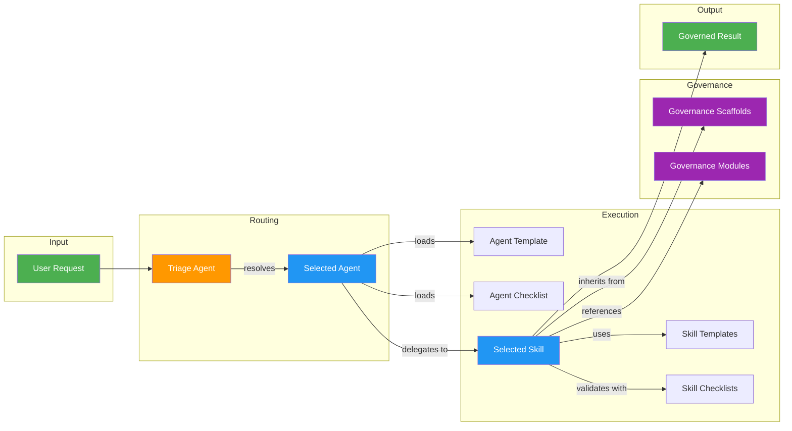
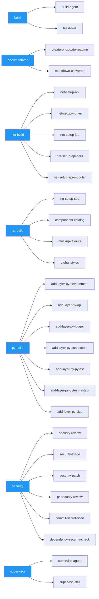
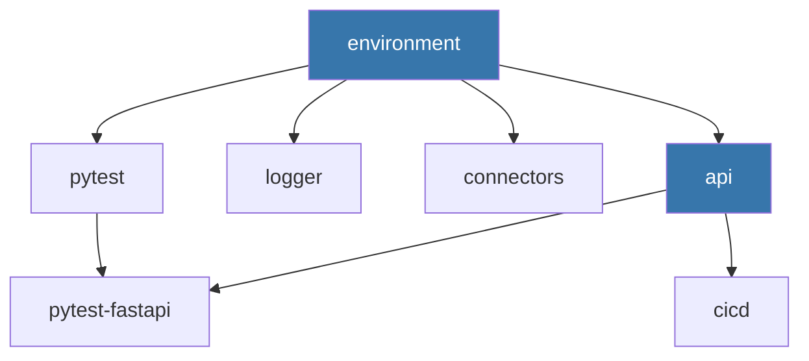

# Architecture

> How the Copilot Governance Framework routes requests through agents, skills, and governance templates to produce deterministic, governed results.

## Design Philosophy

The framework follows three core principles:

1. **Thin Coordinators** — Agents resolve *one bounded path* and delegate all detail to skills
2. **Skill-Owned Detail** — Skills own templates, checklists, validation, and generation logic
3. **Neutral Governance** — Shared scaffolds and standards are decoupled from any specific agent or skill

## System Overview



## Request Lifecycle

Every request follows this deterministic flow:

### 1. Entry Point
The user either:
- Asks the **triage agent** to route their request (recommended for newcomers)
- Calls a **specific agent** directly (e.g., `eleuthia`, `eleuthia`)

### 2. Agent Resolution
The agent:
- Validates the request falls within its scope
- Loads its **companion template** (`.tpl.md`) and **checklist** (`.checklist.md`)
- Resolves which **skill(s)** to delegate to based on deterministic mapping rules

### 3. Skill Execution
The selected skill:
- Loads its own **templates**, **checklists**, and **reference assets**
- Applies governance rules from the shared governance layer
- Generates the governed output

### 4. Validation
Before finalizing:
- The skill validates against its own checklist
- The agent validates against its agent-level checklist
- Any failures require clarification instead of silent improvisation

## Component Relationships

### Agent → Skill Mappings



### Python Layer Dependency Graph

`eleuthia` resolves layer dependencies automatically:



If you request `pytest-fastapi`, the framework will automatically include `environment` → `api` → `pytest` → `pytest-fastapi` in the correct order.

## File Organization

### Agent Bundle Structure

```
.github/agents/
├── {name}.agent.md           # Agent entry point (7-section structure)
└── {name}/                   # Companion directory
    ├── {name}.tpl.md          # Detailed template with rules and examples
    └── {name}.checklist.md    # Validation checklist
```

### Skill Bundle Structure

```
.github/skills/{skill-name}/
├── SKILL.md                  # Skill manifest
├── assets/                   # Templates, checklists, examples
│   ├── {skill-name}.tpl.md
│   ├── {skill-name}.checklist.md
│   └── ...
├── references/               # Reference documentation (optional)
└── scripts/                  # Validation scripts (optional)
```

### Governance Layer

```
.github/governance/
├── bundles/
│   ├── agent/
│   │   └── AGENT.base.tpl.md      # Canonical agent scaffold
│   └── skill/
│       ├── SKILL.base.tpl.md      # Canonical skill scaffold
│       └── SKILL.block-catalog.md # Optional block catalog
└── modules/
    ├── README.md                   # Module documentation
    └── angular/                    # Package fallbacks
```

## Determinism Strategy

All agents use a **Hybrid** determinism strategy:

- **Deterministic:** Routing, profile selection, dependency resolution, and structural rules
- **Adaptive:** Content generation, code scaffolding, and user-facing composition

This means the *structure* of the output is always predictable, while the *content* adapts to the specific request.

## Key Design Decisions

| Decision | Rationale |
|----------|-----------|
| Agents don't contain detailed rules | Keeps agents maintainable; rules live in skill-owned templates |
| Skills own their templates | Enables independent evolution without coordinator changes |
| Governance is neutral | Shared scaffolds work across different agents and skills |
| Checklists are mandatory | Every output must pass validation before being finalized |
| Clarification over improvisation | When in doubt, the system asks instead of guessing |
